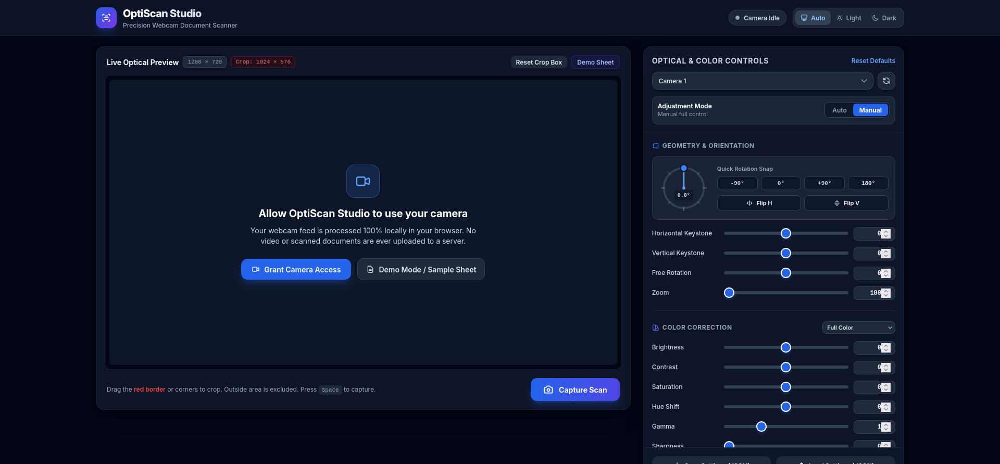
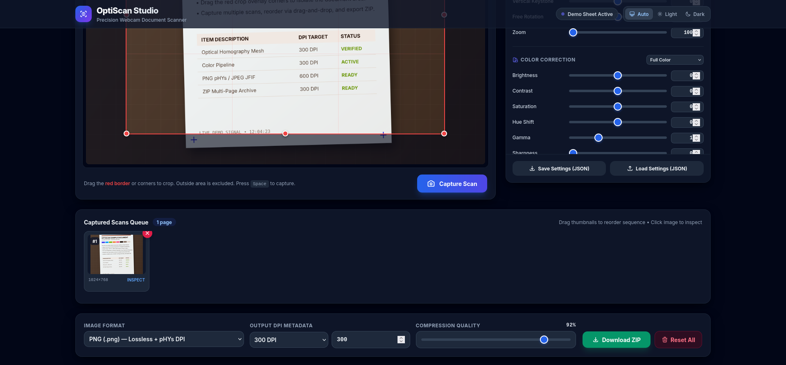

<h1>📷 OptiScan Studio 📄</h1>

A modern, privacy-first, 100% client-side web app to scan physical documents using your webcam directly in the browser. Featuring real-time WebGL keystone correction, OBS-style color grading, a 360° circular rotation dial, interactive cropping, JSON presets, a drag-and-drop filmstrip, and multi-format ZIP export with custom DPI metadata—without any server uploads.

  <a href="http://paypal.me/R0mb0">
    <picture>
      <source media="(prefers-color-scheme: dark)" srcset="https://github.com/R0mb0/Support_the_dev_badge/blob/main/Badge/SVG/Support_the_dev_badge_Dark.svg">
      <source media="(prefers-color-scheme: light)" srcset="https://github.com/R0mb0/Support_the_dev_badge/blob/main/Badge/SVG/Support_the_dev_badge_Light.svg">
      
    </picture>
  </a>

---

<h2><a href="https://r0mb0.github.io/Optiscan_studio/">👉 Click here to test the app! 👈</a></h2>

<h2>🚀 Features</h2>
<ul>
<li><strong>100% Local Processing</strong>: Webcam capture, WebGL image processing, and ZIP archiving happen entirely inside your browser. Your scanned documents never leave your device!</li>
<li><strong>Real-Time WebGL Optical Engine</strong>: Fix perspective distortions on the fly with horizontal and vertical <strong>Keystone (trapezoid)</strong> correction, digital zoom, and automatic 2D Canvas fallback.</li>
<li><strong>360° Rotation Dial &amp; Mirroring</strong>: Freely rotate your framing from -180° to +180° using an interactive circular dial (with quick-snap buttons for -90°, 0°, +90°, 180°), plus instant <strong>Flip Horizontal</strong> and <strong>Flip Vertical</strong> toggles.</li>
<li><strong>OBS-Style Color Grading</strong>: Fine-tune Brightness, Contrast, Saturation, Hue Shift, Gamma, and Sharpness via synced sliders and numeric inputs, or switch between <em>Full Color</em>, <em>Grayscale</em>, <em>Document Enhance</em>, and <em>Auto</em> modes.</li>
<li><strong>Interactive Crop Overlay</strong>: Drag edges, corners, or the interior of the red-bordered crop box directly over the live feed while the outer area dims for clear framing.</li>
<li><strong>JSON Presets (Save &amp; Load)</strong>: Export your exact optical, color, and crop configuration to a <code>.json</code> file and reload it anytime—complete with strict validation to reject malformed files.</li>
<li><strong>Drag-and-Drop Filmstrip Carousel</strong>: Capture multiple pages in sequence, inspect them in a lightbox, delete unwanted shots, and reorder pages effortlessly via drag-and-drop.</li>
<li><strong>Multi-Format ZIP Export &amp; Custom DPI</strong>: Download all captured pages in a single ZIP archive as <strong>PNG</strong>, <strong>JPEG</strong>, <strong>WebP</strong>, or <strong>BMP</strong>, with embedded DPI metadata (pHYs / JFIF / BMP headers).</li>
<li><strong>Built-In Demo Mode &amp; Adaptive UI</strong>: Test every feature without a webcam using the procedural sample sheet, wrapped in a sleek rounded interface with automatic/manual Dark &amp; Light themes.</li>
</ul>

<h2>🛠️ How it works</h2>
<ol>
<li>Grant camera access via the browser prompt and select your preferred <strong>webcam</strong> from the device menu (or launch <strong>Demo Mode</strong> to test immediately).</li>
<li>Adjust the <strong>red crop frame</strong> directly on the live preview and fine-tune <strong>Keystone</strong>, <strong>Rotation</strong>, <strong>Flip</strong>, and <strong>Color</strong> settings from the right control panel.</li>
<li><em>(Optional)</em> Save your setup as a <strong>JSON preset</strong> so you can reuse the exact same desk/camera alignment later.</li>
<li>Click <strong>Capture Page</strong> to snap each document into the bottom filmstrip carousel, where you can preview, delete, or reorder pages by dragging them.</li>
<li>Choose your target <strong>image format</strong> and <strong>DPI</strong>, then click <strong>Download ZIP</strong> to export your entire batch locally.</li>
</ol>

<h2>🏆 What makes it special?</h2>
<ul>
<li><strong>Zero-Backend, Single-File Architecture</strong>: Pure HTML, CSS, and JavaScript with GPU-accelerated WebGL shaders—no installers, no cloud processing, and no file-size limits.</li>
<li><strong>Studio-Grade Control</strong>: Combines document scanning tools (keystone correction, DPI metadata, batch ZIP) with OBS-like camera controls and repeatable JSON presets.</li>
</ul>

<h2>💡 Why use this tool?</h2>
<ul>
<li><strong>Absolute Privacy</strong>: Digitizing IDs, receipts, contracts, or handwritten notes stays strictly on your machine with zero network transmission.</li>
<li><strong>Turn Any Webcam into a Scanner</strong>: Ideal for overhead desk cameras, laptops, or quick document digitization without needing dedicated hardware or bloated desktop software.</li>
</ul>

<h2>⚡ Getting Started</h2>

<h3>Online</h3>

Simply visit the <a href="https://r0mb0.github.io/Optiscan_studio/">Live Demo hosted on GitHub Pages</a>.

<h3>Local Installation</h3>

Running this tool locally is quick and easy:

<ol>
<li><strong>Clone this repository</strong> or download <code>optiscan_studio.html</code>.</li>
<li><em>(Optional, for 100% offline use)</em> Download <code>jszip.min.js</code>, <code>tailwindcss.js</code>, and the <code>Inter</code> font into a local <code>libs/</code> folder and update the paths at the top of the <code>&lt;head&gt;</code> section.</li>
<li>Serve the folder over <code>localhost</code> using a local web server (such as VS Code's <strong>Live Server</strong> or <code>python -m http.server</code>)—required by modern browsers to grant webcam permissions.</li>
<li>Open the local URL in your browser and start scanning!</li>
</ol>

<a href="https://github.com/R0mb0/Crafted_with_AI">
<picture>
<source media="(prefers-color-scheme: dark)" srcset="https://github.com/R0mb0/Crafted_with_AI/blob/main/Badge/SVG/CraftedWithAIDark.svg">
<source media="(prefers-color-scheme: light)" srcset="https://github.com/R0mb0/Crafted_with_AI/blob/main/Badge/SVG/NotMadeByAILight.svg">

</picture>
</a>
